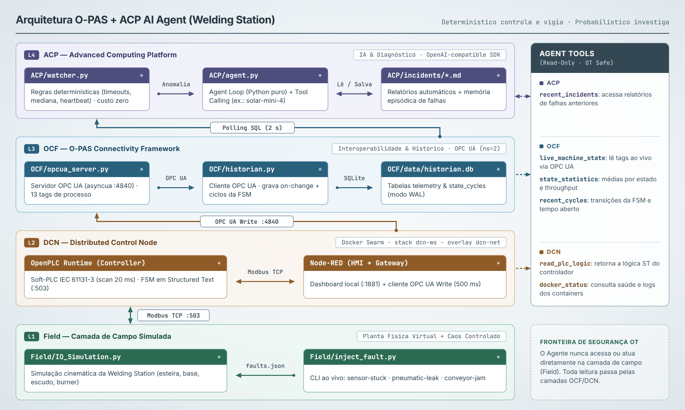

# O-PAS ACP AI Agent — Diagnóstico & Manutenção Preditiva em Automação Aberta

Evolução do protótipo de **Nó de Controle Distribuído (DCN)** baseado no padrão **O-PAS** ([`s-pedrolima/tcc-opas`](https://github.com/s-pedrolima/tcc-opas)), adicionando a camada **OCF** programática (OPC UA + Historian) e materializando a camada **ACP (Advanced Computing Platform)** com um **Agente de IA** para diagnóstico de causa raiz, análise de gargalos e monitoramento preditivo de uma estação de soldagem industrial (*Welding Station*).

---

## Propósito do Projeto

Este repositório foi construído para explorar na prática como integrar **LLMs e Agentes de IA a sistemas reais de Engenharia/OT** sem violar princípios de confiabilidade industrial.

O projeto aplica um princípio fundamental de sistemas híbridos:

> **Determinístico controla e vigia. Probabilístico investiga.**

- **Malha de controle (`DCN` / OpenPLC, 20 ms):** 100% determinística em IEC 61131-3 (*Structured Text*). A IA nunca entra na malha de tempo real.
- **Vigilância contínua (`ACP/watcher.py`):** regras determinísticas baratas (timeouts por estado, mediana de degradação e heartbeat de telemetria) rodam continuamente sobre o SQLite com **custo zero de LLM**.
- **Investigação e diagnóstico (`ACP/agent.py`):** acionado sob demanda (chat/CLI) ou automaticamente pelo Watcher quando uma anomalia real ocorre. O agente cruza múltiplas fontes via **Tool Calling** (OPC UA ao vivo, Historian, lógica do PLC, Docker Swarm e memória de incidentes) para apontar a causa raiz e recomendar ações de manutenção.

---

## Arquitetura (Camadas O-PAS)



### Estrutura de Diretórios

```text
./
├── Field/                      # Camada de Campo (planta simulada + injeção de falhas)
│   ├── IO_Simulation.py        # Simulação cinemática da Welding Station (Modbus TCP)
│   └── inject_fault.py         # CLI para injetar/limpar falhas em tempo real
├── DCN/                        # Distributed Control Node
│   ├── Controller/             # Lógica IEC 61131-3 em Structured Text (plc.xml)
│   ├── HMI/                    # Fluxos Node-RED: Dashboard local + Gateway OPC UA
│   └── Infra/                  # Manifesto Docker Swarm (WeldingStation.yml) e Dockerfile
├── OCF/                        # O-PAS Connectivity Framework
│   ├── opcua_server.py         # Servidor OPC UA em Python (asyncua, ns=2)
│   ├── historian.py            # Cliente OPC UA -> SQLite (on-change + ciclos da FSM)
│   └── data/                   # Banco historian.db (ignorado pelo git)
├── ACP/                        # Advanced Computing Platform
│   ├── tools.py                # 6 ferramentas somente-leitura + schemas JSON
│   ├── agent.py                # Agent Loop em Python puro (OpenAI SDK)
│   ├── watcher.py              # Detector determinístico que aciona o agente
│   └── incidents/              # Relatórios de incidentes gerados automaticamente
├── assets/                     # Recursos visuais da documentação (architecture.png)
├── Simulation.sh               # Orquestração local de todas as camadas (start/stop/status)
├── requirements.txt            # Dependências Python do projeto
└── .env.example                # Modelo de configuração da API da LLM
```

### Ferramentas (Tools) Disponíveis para o Agente

| Tool | Fonte de Dados | Papel no Diagnóstico |
| :--- | :--- | :--- |
| `get_live_machine_state` | Servidor OPC UA (`asyncua`) | Lê em tempo real o `Machine_State`, 7 atuadores e 5 sensores |
| `get_state_statistics` | Historian (`SQLite`) | Média, mín/máx por estado, ciclo médio e throughput (peças/h) |
| `get_recent_cycles` | Historian (`SQLite`) | Últimas transições da FSM e tempo decorrido (`elapsed_sec`) do estado aberto |
| `read_plc_logic` | `DCN/Controller/plc.xml` | Extrai variáveis (`%IX`, `%QX`, `%MW`) e o código Structured Text limpo |
| `get_docker_status` | Docker Swarm CLI | Checa réplicas, versão da imagem, histórico de restarts e logs de OpenPLC/Node-RED |
| `get_recent_incidents` | `ACP/incidents/*.md` | Memória episódica de incidentes anteriores para correlacionar recorrências |

---

## Como Usar

### Pré-requisitos

- Linux com **Docker Engine** ativo (`docker swarm init` inicializado)
- **Python 3.11+**
- Uma chave de API compatível com o padrão OpenAI (ex.: **Upstage `solar-mini-4`**, Groq, Gemini AI Studio ou OpenRouter)

### 1. Setup do Ambiente

```bash
# 1. Inicialize o Docker Swarm (se ainda não estiver ativo) e baixe as imagens do DCN
docker swarm init
docker pull spedrol/soft-plc-ws:1.0
docker pull spedrol/system-monitor-ws:1.0

# 2. Crie o ambiente virtual Python na raiz e instale as dependências
python3 -m venv .venv
./.venv/bin/pip install -r requirements.txt

# 3. Configure a API da LLM
cp .env.example .env
# Edite o .env preenchendo LLM_API_KEY, LLM_BASE_URL e LLM_MODEL
```

### 2. Subir Todas as Camadas (`Simulation.sh`)

```bash
# Inicia OPC UA -> Docker Swarm (OpenPLC + Node-RED) -> Simulação -> Historian -> Watcher
./Simulation.sh start

# (Opcional) Sobe o Watcher em modo dry-run (detecta anomalias sem chamar a LLM)
./Simulation.sh start --dry-run

# Verifica containers, processos Python e falhas ativas
./Simulation.sh status

# Encerra todos os serviços Python de forma limpa e remove a stack Swarm
./Simulation.sh stop
```

- **Dashboard HMI (Node-RED):** `http://localhost:1881/dashboard/page1` (aguarde ~25 s após o `start`)
- **Resumo do Historian (SQLite):**
  ```bash
  ./.venv/bin/python OCF/historian.py --summary
  ```

### 3. Conversar com o Agente Sob Demanda

```bash
# Modo chat interativo (use -v para ver o JSON completo de cada tool call)
./.venv/bin/python ACP/agent.py -v

# Pergunta única direta via CLI
./.venv/bin/python ACP/agent.py "Qual o desempenho histórico da máquina e qual o maior gargalo?"
```

### 4. Injetar Falhas Reais ao Vivo (Testando o Watcher + Agente)

Com o ambiente rodando, dispare falhas sem reiniciar a simulação:

```bash
# Falha 1: Travamento de sensor de fim de curso (dispara `state_timeout`)
./.venv/bin/python Field/inject_fault.py sensor-stuck shield_down false

# Falha 2: Degradação pneumática lenta (dispara `slow_degradation` após ~3 ciclos)
./.venv/bin/python Field/inject_fault.py pneumatic-leak --factor 0.6

# Falha 3: Travamento mecânico da esteira
./.venv/bin/python Field/inject_fault.py conveyor-jam

# Consultar perfil ativo / restaurar operação normal
./.venv/bin/python Field/inject_fault.py status
./.venv/bin/python Field/inject_fault.py clear
```

Quando o Watcher detecta alguma falha o agent é disparado automaticamente, e os relatórios gerados ficam salvos em `ACP/incidents/`.
